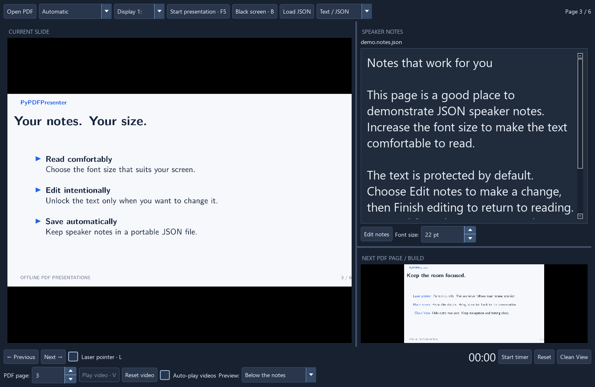
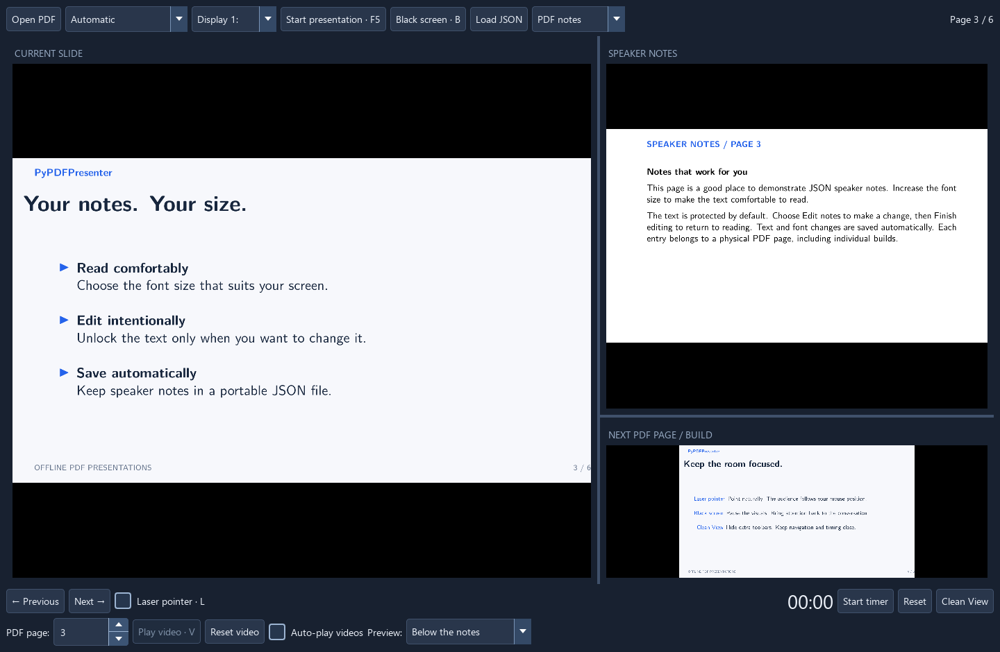
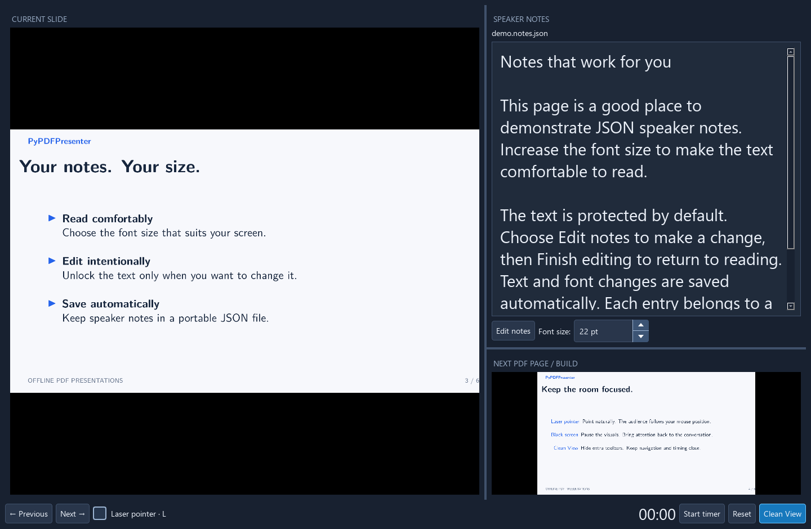

# PyPDFPresenter

**A focused, offline PDF presenter with two-screen output and comfortable speaker notes.**

Keep your slides on the audience screen and your notes, next page and timer
on your own display. PyPDFPresenter is a small Python desktop application,
built with PySide6 and PyMuPDF. No account or cloud service is required.





Both screenshots use **Below the notes** for the next-slide preview.

## Features

- Separate presenter and full-screen audience windows.
- PDF notes on the left/right, or editable JSON notes for ordinary PDFs.
- Adjustable text size, protected reading mode and automatic note saving.
- Three layouts for the next slide and its notes.
- Synchronized laser pointer, black screen, timer and Clean View.
- Supported embedded MP4 video playback with optional auto-play.
- Background rendering and a persistent local image cache.
- German UI on German systems; English UI for all other system languages.

The current build is tested on Windows 11 with Python 3.13. The source uses
cross-platform Qt APIs, but Linux and macOS have not yet been validated.

## Try the demo

The repository includes an English demo in two formats:

- [Slides only](examples/demo.pdf), paired with [JSON speaker notes](examples/demo.notes.json).
- [Wide presenter PDF](examples/demo-presenter.pdf), with speaker notes on the right.

Run the demo from source:

```sh
python -m pip install -r requirements.txt
python software/presenter.py --demo
```

The demo contains six slides with talking points and an original embedded MP4.
The PDFs, JSON, Beamer TeX source and media are in [examples](examples/README.md).
The TeX source has a switch for compiling with or without PDF speaker notes.
See the [manual compilation instructions](examples/README.md#rebuild-by-hand).

## Run from source

Requires Python 3.10 or newer. From the project directory:

```sh
python -m venv .venv
```

Activate the environment with `.venv\Scripts\activate` on Windows, or
`source .venv/bin/activate` on Linux/macOS, then:

```sh
python -m pip install -r requirements.txt
python software/presenter.py
```

The app opens an empty workspace. Choose **Open PDF**, or pass a file directly:

```sh
python software/presenter.py slides.pdf --speaker-notes slides.notes.json
python software/presenter.py examples/demo-presenter.pdf
python software/presenter.py --demo --language en
```

`--language auto` follows the system locale. `--language de` and `--language en`
override it. The presentation content and your notes are never translated.

## Present

1. Open a PDF and choose the audience display.
2. Use **Automatic** layout detection, or select the PDF notes position manually.
3. Load a JSON file if your deck has no PDF notes, or choose **Create notes**.
4. Press **F5** or **Start presentation**. The button switches to **Stop presentation**.

The audience window shows only the slide region. Check the display selection
with your projector connected before a talk.

| Action | Control |
| --- | --- |
| Previous / next PDF page | Left / Right, Page Up / Page Down, Space |
| First / last page | Home / End |
| Start / stop presentation | F5 |
| Hide audience window | Escape |
| Laser pointer | L, then move the mouse over the current/audience slide |
| Black screen | B |
| Play / pause supported video | V, or click its slide region |
| Reset video | Reset video button |
| Start / pause / reset timer | Timer buttons |
| Hide header and lower toolbar | Clean View; click again to restore |

Navigation and laser controls stay on the left of the upper footer. The clock,
timer controls and Clean View stay on the right. Controls keep their natural
size in maximized windows. The lower footer contains the page selector,
video controls and a compact preview layout menu.



## Speaker notes

Choose **PDF notes** or **Text / JSON** in the header.

For text notes, **Edit notes** unlocks the current page's text; **Finish editing**
protects it again. If no JSON is loaded, the same button becomes **Create notes**.
Choose a file name once, then start writing. Selecting an existing file loads
its content instead of clearing it.

Text changes save automatically after a short pause and immediately when
editing ends or the app closes. The font size remains adjustable in reading
mode and is also saved. If writing fails, the app reports the error and retains
the text in memory. Presentation letter/arrow shortcuts are suspended while
editing, so they do not consume your keystrokes.

```json
{
  "version": 1,
  "pdf": "slides.pdf",
  "font_size": 22,
  "notes": {
    "1": "Welcome to the presentation.\n\nIntroduce the topic.",
    "2": "Explain the next step."
  }
}
```

Keys are **physical PDF page numbers starting at 1**, including individual
builds/overlays. They are not printed slide labels. Missing entries appear
empty; entries beyond the current PDF are preserved. The `pdf` field is a
human-readable hint, not a strict binding. Files use UTF-8. Font size is 10-64 pt.

PDF notes remain rendered images, with no independent font adjustment.
The JSON status and font control are hidden in PDF notes mode.

## PDF layouts and video

Automatic detection uses the first page's aspect ratio: pages wider than 2.5:1
are treated as slide-left / notes-right; ordinary pages are shown in full.
Use the manual selection for other layouts.

Embedded video support is limited to recognized Screen/Rendition annotations
and some Movie annotations referencing a file specification. One video per
page is displayed at its authored position on both windows. Moving to another
page stops it; blacking out or stopping the audience window pauses it.
RichMedia/Flash, PDF JavaScript, animated PDF content, clickable links and
password-protected files are not supported.

Slides are rasterized to 1920 pixels wide and cached; this is intended for
Full HD presentation rather than arbitrary PDF zooming. A page that has not
finished rendering is briefly black. Reopen a PDF after editing its file.
Caches use Qt's local cache directory; set `PYPDFPRESENTER_CACHE_DIR` to override it.

## Build a Windows application

```sh
python -m pip install -r requirements.txt
python software/Build_exe.py
```

The script uses the active Python environment and can be called from any directory.

The portable folder is `dist/PyPDFPresenter/`. Keep its `_internal` directory
with the executable. Launch `PyPDFPresenter.exe`, drag a PDF onto it, or run
`PyPDFPresenter.exe --demo`. The spec includes the demo, icons, German Qt
translations and license notices. It excludes a conflicting MSYS2 `icuuc.dll`
on Windows so Qt uses the operating system's ICU library.

## Contributing

See [CONTRIBUTING.md](CONTRIBUTING.md) and the
[local publishing checklist](docs/PUBLISHING.md).
The GitHub Actions workflow builds a Windows artifact.
It does not publish a release automatically.

## License

Application source, demo and screenshots: **AGPL-3.0-only**, see [LICENSE](LICENSE).
Dependencies keep their own licenses; see [THIRD_PARTY_NOTICES.md](THIRD_PARTY_NOTICES.md).
PyMuPDF is offered under AGPL or a separate commercial license, as described in
its [official license information](https://pymupdf.readthedocs.io/en/latest/about.html#license-and-copyright).

PyPDFPresenter is an independent application.
